# 2027集创赛备赛学习日志：从零构建异构计算开发环境
**记录时间：** 2026年10月19日  
**目标赛道：** 复旦微赛道(异构融合AI创新 基于FMQL30TAI)  
**当前阶段：** 软硬件基础开发环境搭建(基于Zynq7020的PetaLinux初步探索)  
**硬件平台：** Windows宿主机(AMD Ryzen 9 7945HX，16GB RAM，RTX4060)+VMware Workstation + Zynq7020开发板  
鉴于FMQL30TAI目前要好几万块，而且对于学生而言有价无市。所以在淘宝上有很多第三方厂商做的7020，随便买一个就可以。1500元左右。至于30TAI独有的NPU架构，后面学到的时候再考虑吧，先把异构融合架构搞明白。

## 一、备赛目标和总体策略
本届集创赛我计划挑战复旦微赛道。参考2026年赛题，核心考察点在于利用FMQL30TAI(集成了ARM CPU、FPGA、NPU的异构融合板卡)实现端侧AI应用，FPGA在整个系统要有明确的加速系统的作用，三者更是要分工明确。  
基于端侧AI的爆发趋势，以及复旦微集团正在主推FMQL30/100/400TAI系列板卡的趋势，我觉得2027年复旦微赛道依然会是这个方向，所以我确立了前期的备赛主线：**构建一条“摄像头采集->FPGA处理->NPU推理->CPU后处理->显示”的最小异构流水线**，用来熟悉比赛板卡。  
虽然复旦微的工具链和Xilinx生态有本质区别**需要使用Procise生成BSP/FSBL，IAR编译裸机，以及专用的AI量化工具ICraft**，但是我所构建的最小异构流水线中，除了NPU推理阶段，其余阶段均可使用7020完成，也可以为后续攻克FMQL复杂异构启动链路打地基。  

## 二、底层环境搭建：清楚虚拟化障碍
对于Zynq7020，我们使用的开发工具是Vivado2018.3, SDK, Petalinux2018。
| 工具 | 功能 |
| :---: | :---:|
| Vivado2018 | 核心硬件开发环境。负责Zynq PS（处理系统）的配置、PL（可编程逻辑）的设计与综合、布局布线，并生成最终的比特流文件。 |
| SoftwareDevelopmentKit | 基于Eclipse的集成开发环境（IDE），用于在Zynq的ARM核上进行裸机或FreeRTOS应用程序的开发、编译和调试。 |
| Petalinux2018 | 用于基于Zynq构建、定制和部署嵌入式Linux系统的完整工具链。它自动化了生成U-Boot、Linux内核、设备树和根文件系统等复杂过程。 |

这一套工具是完全适配的，并且在网上的资源比较多，适合我们拿来使用。不过从Vivado2019.2开始，AMD就把SDK集成到了Vitis这个工具中，后续也可以使用这款工具。上面表格中的开发流程，对于FMQL系列板卡而言也是相同的，所以我们要先熟悉这中开发链路。

Vivado2018.3提前下载好，附一个网盘链接：这个是我自己的资源，永久有效。
运行setup.exe，一路next，软件让我们用更新版不要用，然后选择HL完全版，后面会自动打开许可证管理器，把lic文件解压后，在管理器里面选择许可证就OK了。记得选芯片的时候选上zynq7000s系列。  
[Vivado 2018.3](https://pan.baidu.com/s/1ckFiUfEyuy1f_mMK6MZKCw?pwd=9999)

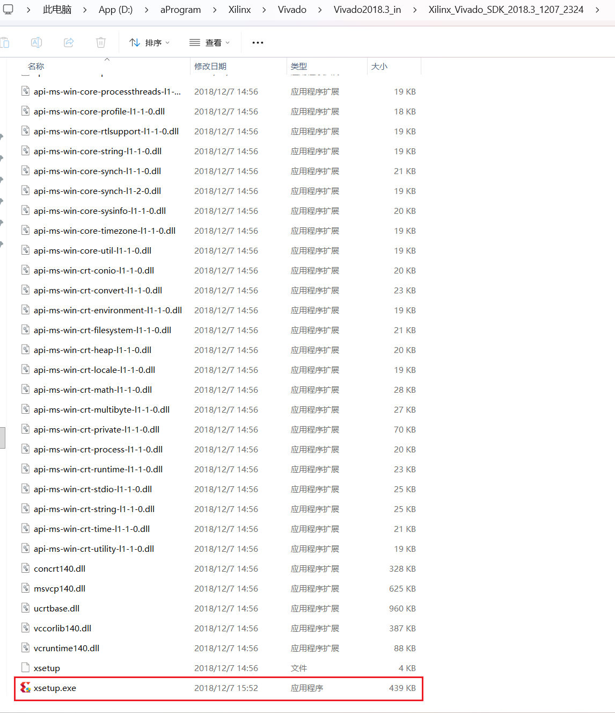

**开始构建虚拟机！！**  
因为Petalinux一定是运行在Linux系统里面的工具，所以我们要创建一个linux虚拟机，又因为AMD官方给Petalinux2018指定的优化好的linux系统是Ubuntu2018，且2018.04是Ubuntu最后的更新版本并且维护的很好，所以就用它了~~(如果使用更新的版本，比如20.04，会遇到一大堆问题，这里我踩坑的图片就不放出来了)
点击下方链接，直达清华镜像站，下载Ubuntu的镜像文件。
[Ubuntu2018.04.6](https://mirrors.tuna.tsinghua.edu.cn/)
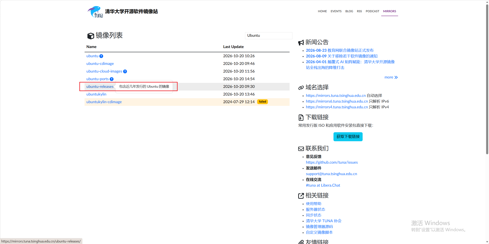
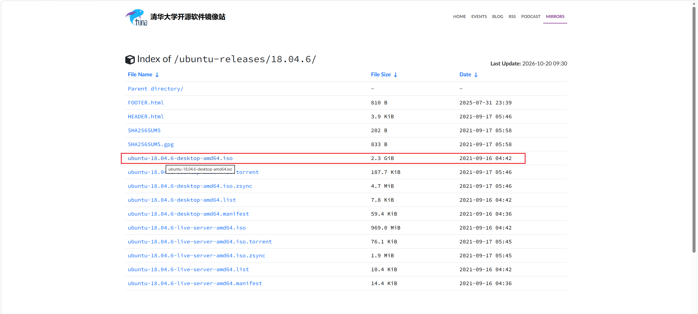
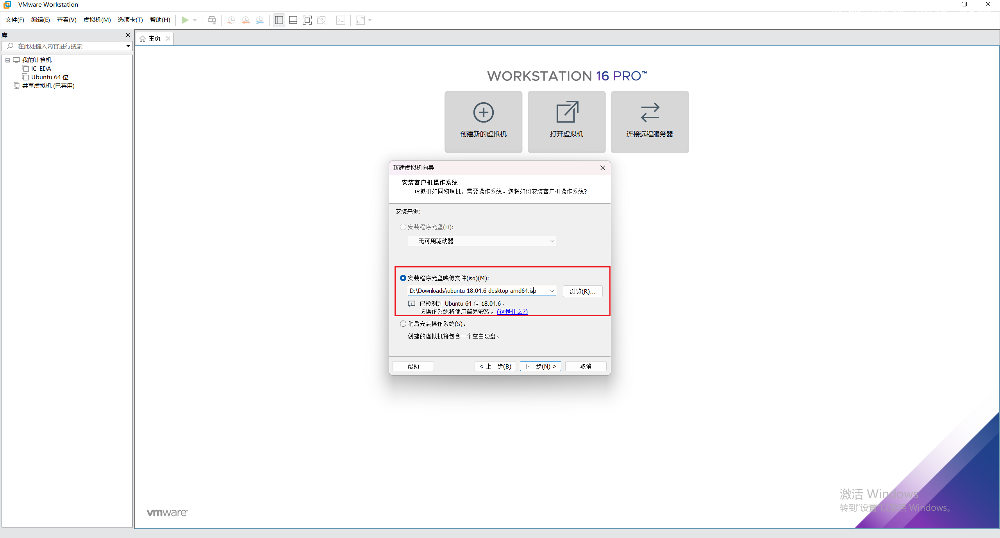

安装虚拟机的时候，选择经典引导方式，然后选中自己的镜像文件，然后配置起码200GB存储，8GB内存，1个8核的CPU处理器

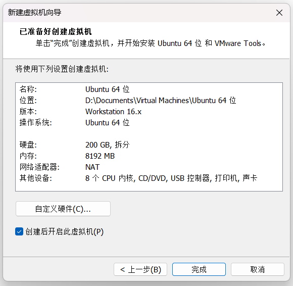
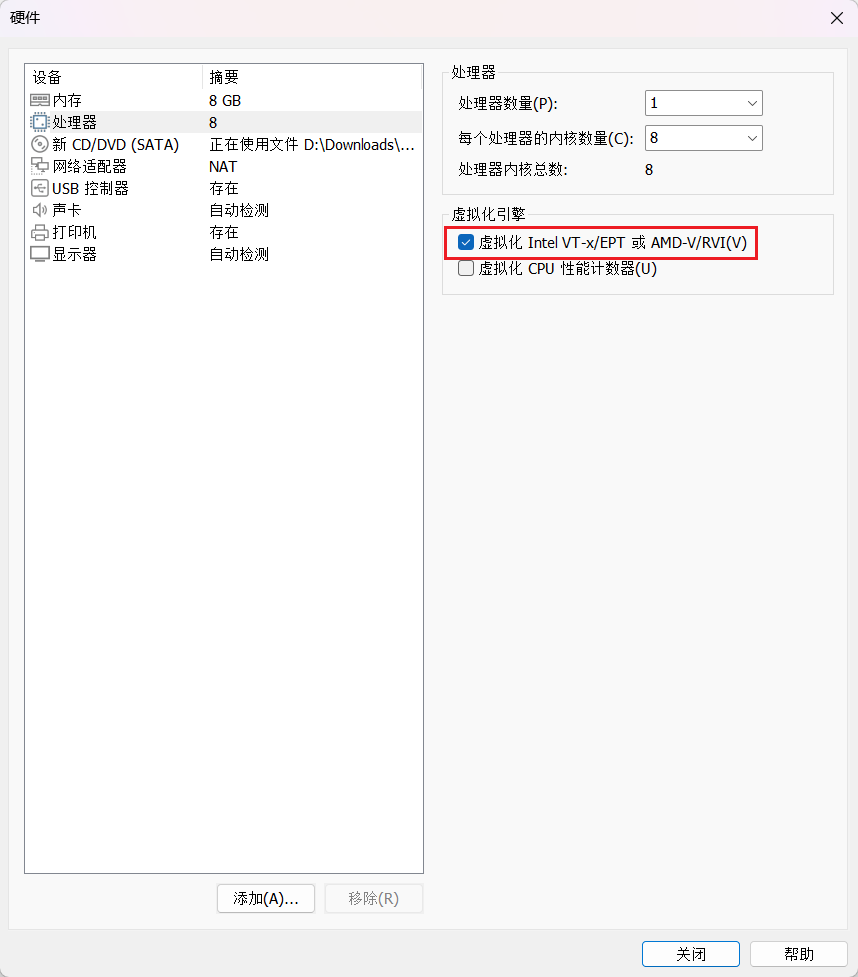

上面这张图片很重要，先不勾选虚拟化处理器，正常创建虚拟机，如果能打开虚拟机(如果打不开的话我也没办法了，上网求助吧)，就再回来把它勾上！  
勾上之后，如果打不开了并显示无法虚拟化处理器，那就是很正常情况，因为Windows宿主默认独占了这个虚拟化处理器的功能，这样会导致我们的虚拟机性能很差，没法直接调用CPU的底层硬件，严重拖累后期的编译。一般经常使用虚拟机的开发人员都会把这个虚拟化功能释放给虚拟机（这样做其实是即增强了宿主的性能，也增强了虚拟机的性能，因为宿主不需要运行一段很底层的程序来维持这个独占的功能，并且我们的虚拟机也可以调用底层的硬件了。之所以还有这个事儿，是因为这个功能提高了主机的安全性，避免恶意软件插入到我们的高优先级进程中，其实目的是保护一般用户的，我们开发人员很少会让自己的电脑被入侵：如果你担心自己被流氓软件绑架的话当我没说）

这里如果你的windows是家庭版，就需要先升级为专业版，Github上有一个开源软件很好用，我把链接附上，可以一键升级。直接整个下载下来吧！
[云萌Windows升级](https://github.com/TGSAN/CMWTAT_Digital_Edition)

只能把win10和win11的家庭版升为专业版，不可以把win10变成win11(这是需要刷机的)，依次点击两个按钮就OK啦！

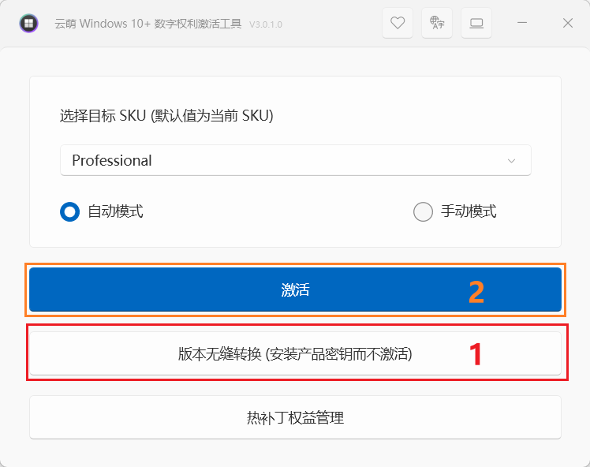

接下来，我们的主机就是可以关闭虚拟化功能的了(但是还没有关闭)
先去Windows官网下载一个插件，这是官方指定的关闭虚拟化功能的工具。
[Device Guard](https://www.microsoft.com/en-us/download/details.aspx?id=53337)

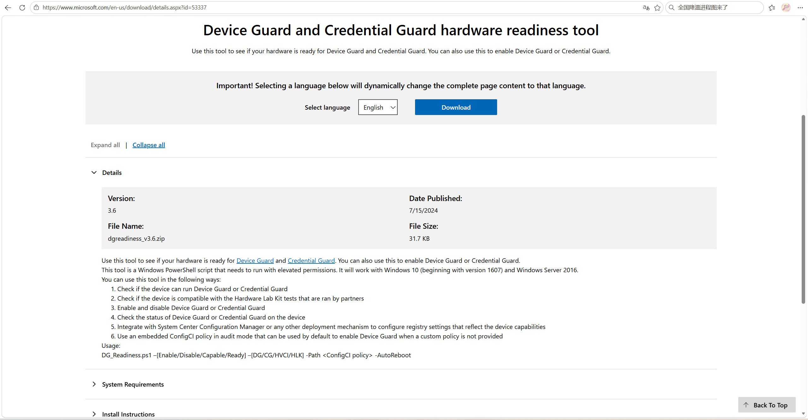
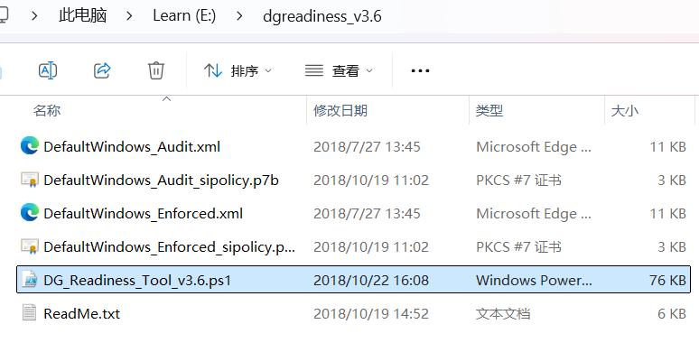

插件下载后，打开管理员终端，先进入安装插件的目录，输入下方指令，回车即可
```powershell
.\DG_Readiness_Tool_v3.6.ps1 -Disable
```
只要最后提示让我们重启电脑让配置生效即可
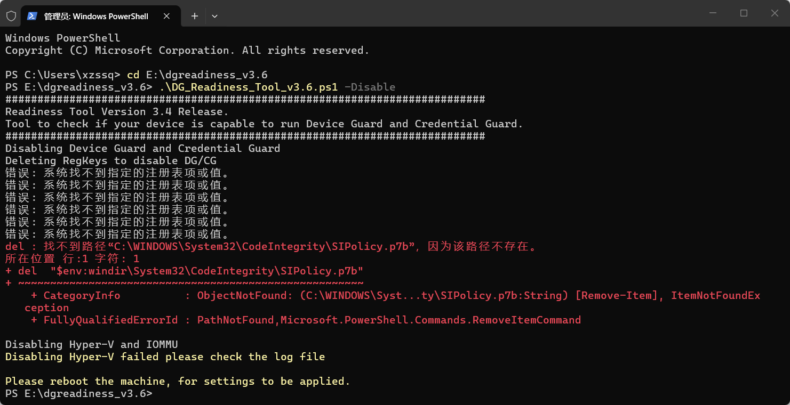

重启电脑，然后WIN+R，再输入msinfo32，进入系统信息查看界面，如果选项‘基于虚拟化的安全性’右侧是‘未启用’，就可以了！当然重启的时候，电脑屏幕会有提示你是否真的要关闭安全保护功能，我们顺着提示选择确认即可。然后重新打开虚拟机，就好了。
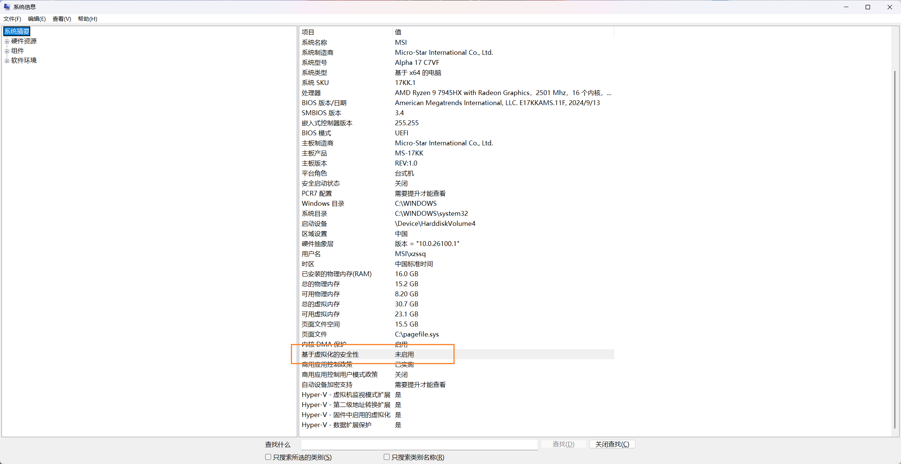

虚拟机开启过程中可能有各种提示，我们不管不顾，只要能打开虚拟机，能打开控制台就好~~


在虚拟机终端执行以下指令，如果结果不是0，而是和我们设置的CPU数量一致，就说明所有核心均已经可以调用底层硬件执行编译功能了。
```bash
egrep -c '(vmx|svm)' /proc/cpuinfo
```
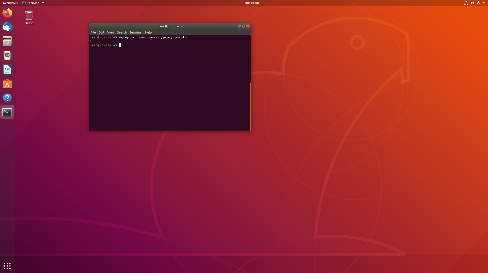

## 三、Linux宿主环境配置
执行以下代码，以sudo执行指令，终端第一次会要求我们输入密码，凭感觉输入正确，回车即可。
```bash
sudo bash -c "cat > /etc/apt/sources.list << 'EOF'
deb http://mirrors.aliyun.com/ubuntu/ bionic main restricted universe multiverse
deb http://mirrors.aliyun.com/ubuntu/ bionic-security main restricted universe multiverse
deb http://mirrors.aliyun.com/ubuntu/ bionic-updates main restricted universe multiverse
deb http://mirrors.aliyun.com/ubuntu/ bionic-proposed main restricted universe multiverse
deb http://mirrors.aliyun.com/ubuntu/ bionic-backports main restricted universe multiverse
EOF"

# 更新软件列表
sudo apt update
```

执行下面的命令后，会弹出灰蓝色界面，选择no，我们要使用更全能的bash终端，而不是更快捷的dash终端
```bash
sudo dpkg-reconfigure dash
```

添加32位架构支持，因为petalinux2018有点老，可能有些地方会依赖32位架构的编译器
```bash
sudo dpkg --add-architecture i386
sudo apt update
```

安装Petalinux的依赖包
```bash
sudo apt install -y tofrodos iproute2 gawk gcc g++ git make net-tools libncurses5-dev tftpd zlib1g-dev libssl-dev libselinux1 flex bison libstdc++6 zlib1g:i386 xvfb autoconf libtool automake lib32z1 lib32ncurses5 lib32stdc++6 chrpath socat xterm python texinfo gcc-multilib build-essential libsdl1.2-dev libglib2.0-dev
```

配置TFTP服务
```bash
sudo apt install -y tftpd-hpa
sudo systemctl enable tftpd-hpa
sudo systemctl start tftpd-hpa
```

关闭后台自动更新功能(防干扰)
```bash
sudo dpkg-reconfigure unattended-upgrades
```

