# Vivado构建硬件执行文件
**记录时间：** 2026年10月20日  
**当前阶段：** 构建硬件执行文件  

## 一、 利用Vivado的IP核快速构建原型
已经安装好Petalinux后，需要从windows的Vivado中构建出Zynq的硬件架构文件，比如串口，内存DDR，SD卡等等，构建好一个原型后，到处.hdf文件(新版本已经不是这个文件了)，把.hdf文件通过共享文件夹给到Petalinux，就可以自动化给我们整合出可以启动Zynq的程序，我们给到板子，板子就可以启动了！

先创建空白工程，选择Zynq7020的芯片，然后在左侧导航栏找到IP Intergrator栏目下的Block Design，创建一个新的block，然后添加IP核，选择**Zynq7 prossing system**。
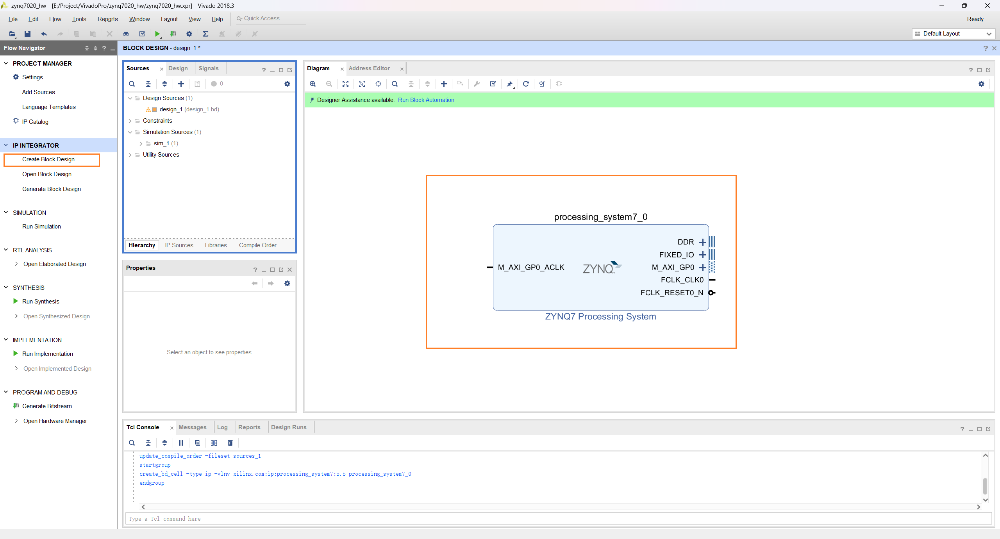

这个IP核很厉害，相当于直接扮演配置PS端的角色，它包含了ARM CPU、DDR控制器、外设接口、引脚复用。
它是一个硬核，已经刻在FPGA的硅片上了，不需要再消耗逻辑资源，我们在Vivado中的配置，其实是画一张接线图，告诉系统怎么激活并使用这些现成的硬件，所以也就告诉我们为什么一定要有一个.hdf文件给到Petalinux。

点击自动设计，系统会自动引出DDR和FIXED_IO。
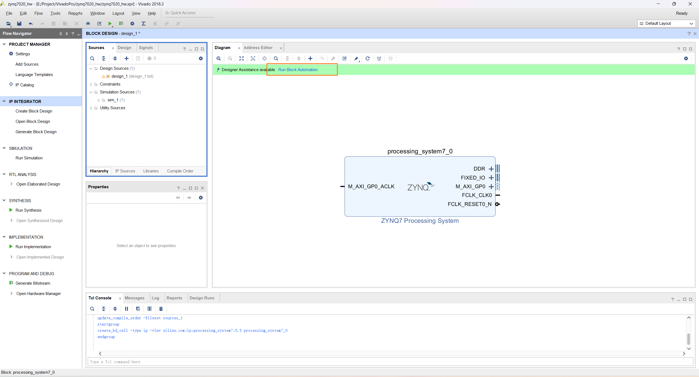
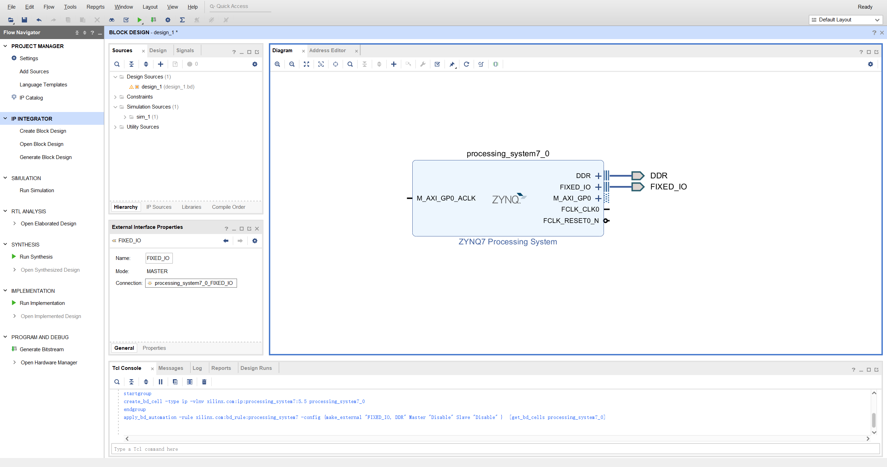

接着点击中心的芯片图标进入配置界面，然后进入Peripheral I/O Pins设置外设引脚，最少选中UART 1, SD0, Ethernet 0, TTC 0,分别用来linux串口打印，SD卡启动，网口设置，系统时钟。再点击DDR configuration，确认DDR规格是否和手上的板子一致(如果手上没板子，跳过就行)

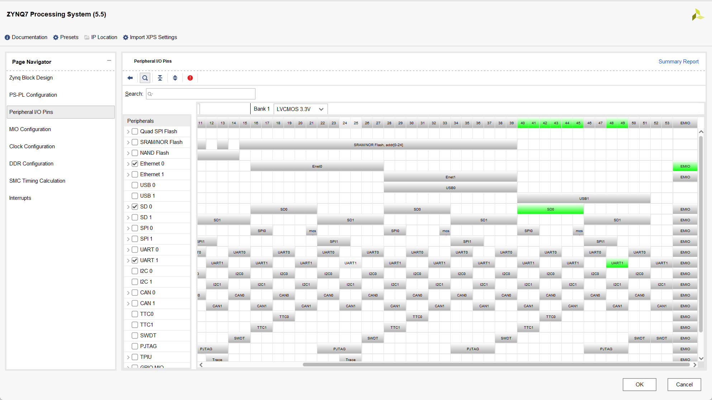
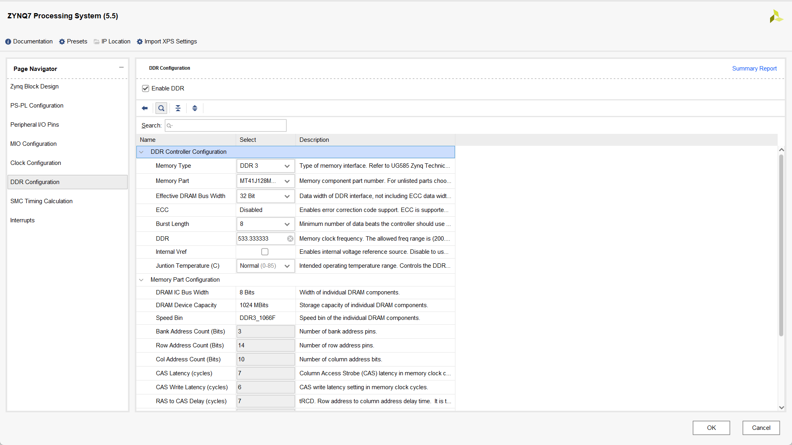
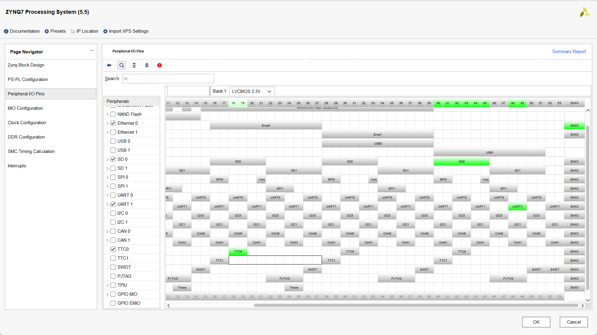

保存设置，然后将M_AXI_GP0_ACLK和FCLK_CLK0连结在一起，原因是在zynq架构中，PS端和PL端是通过AXI总线进行通信的，M_AXI_GP0就是PS作为主设备访问PL的接口，为了保证数据传输的稳定，这个接口必须有一个时钟信号来同步，而M_AXI_GP0_ACLK就是这个时钟的输入端。
这个时钟通常由PS端的FCLK_CLK0来提供，就是PS提供给PL的一个基准时钟。
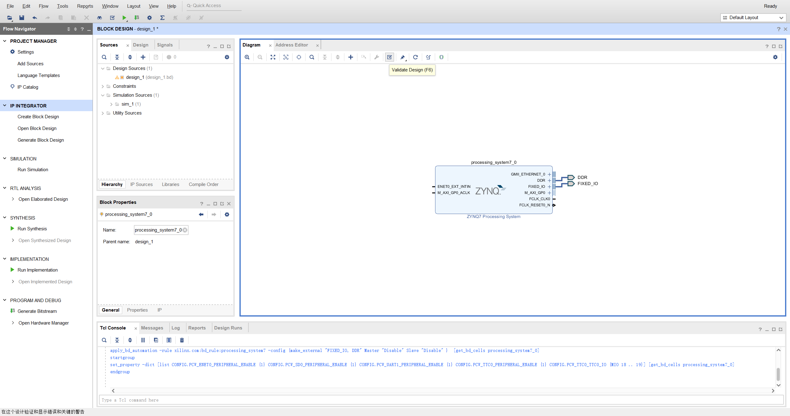
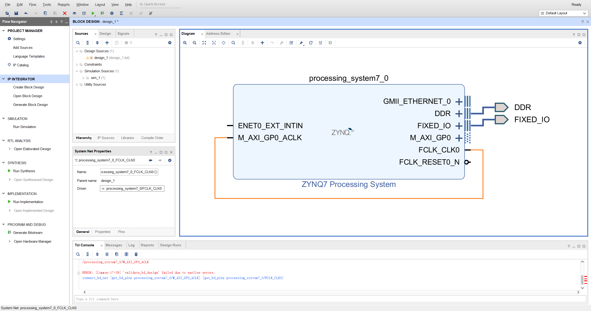

不过由于我们当前阶段还没有在PL端设计任何自定义的IP来进行加速，暂时用不到AXI总线去访问PL端，直接把这个接口关掉也没问题。下图中的勾选框，取消掉就好了。
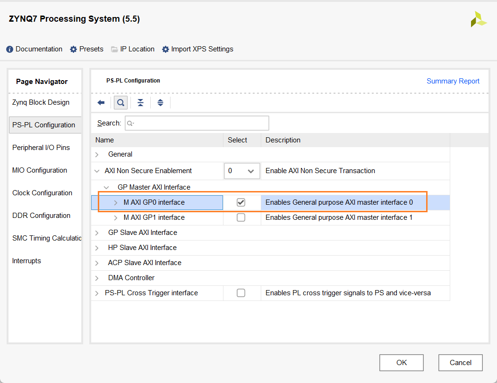

然后创建硬件包装，会自动生成一个顶层文件。
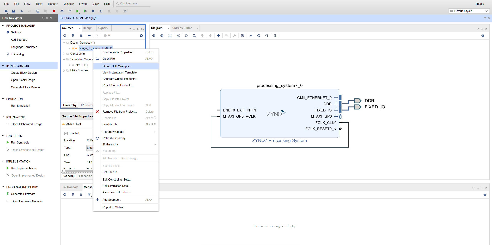
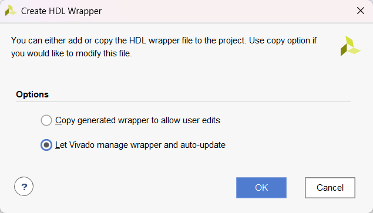

之后直接生成bit流即可，一路OK，系统自动进行综合与实现。
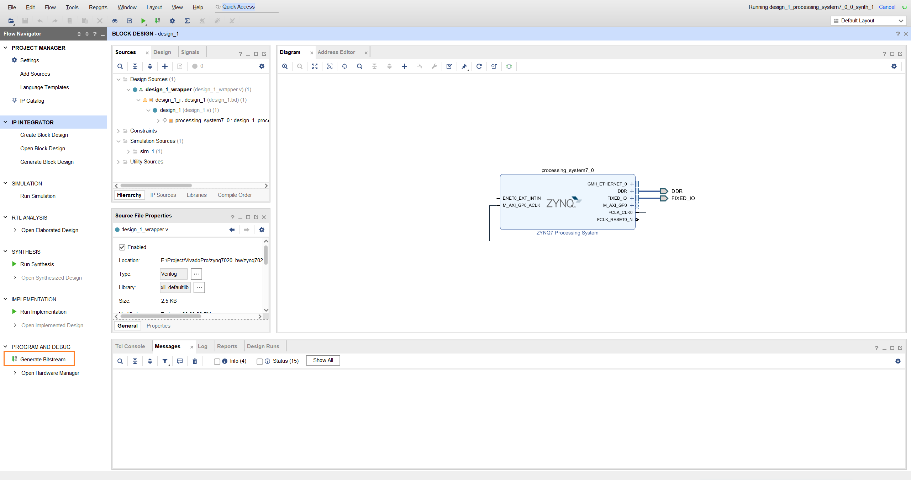

最后到处硬件文件，务必勾选包含bitstream选项，否者Petalinux拿到的就是没有硬件逻辑的文件，会出错。
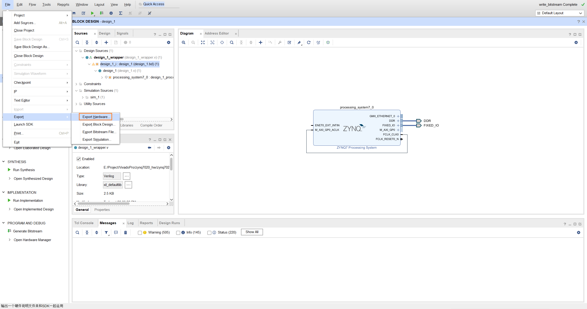
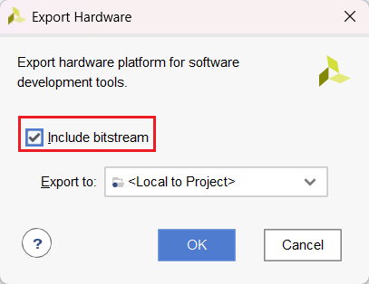

找到生成的文件，并复制到共享文件夹，然后我们去虚拟机完成之后的操作！
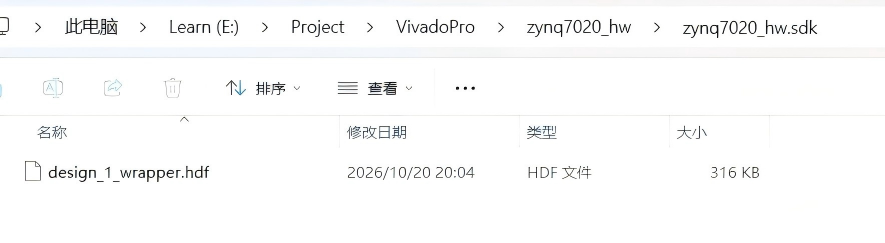

## 二、 利用Petalinux生成Zynq启动文件
有的时候可能虚拟机检测不到共享文件夹，可以先检查一下，如果返回了共享文件夹的名称，则说明虚拟机底层的共享文件夹机制是通的，只是没挂载到/mnt/hgfs/里面，再按照之前的方式挂在一下就好。
``` bash
# 检查共享文件夹指令
vmware-hgfsclient

# 手动挂载指令
sudo /usr/bin/vmhgfs-fuse .host:/ /mnt/hgfs -o allow_other -o uid=1000 -o gid=1000 -o umask=022
```

再把共享文件夹中的.hdf文件复制到虚拟机主目录下的我们的工作空间中
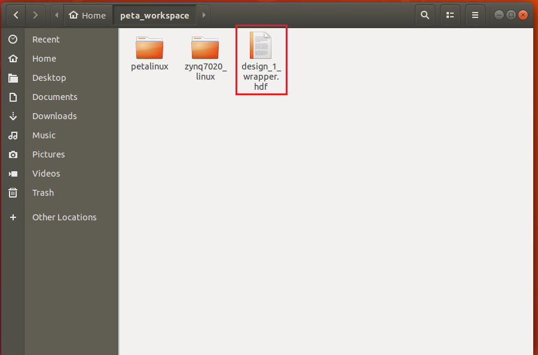

之后就可以创建Petalinux的工程文件了，这个工程就对应我们刚刚的hdf文件，之后就是一个hdf对应一个工程~
``` bash
petalinux-create -t project --template zynq -n zynq7020_linux
# create指令的帮助
petalinux-create --help
petalinux-create --h
```
其他petalinux指令
| 指令 | 功能 |
| :---: | :---: |
| petalinux-config | 导入从Vivado中导出的hdf或者xsa文件|
| petalinux-build | 全量编译 会先检查依赖，然后把 U-Boot、Kernel、设备树、Rootfs 全部编译一遍。第一次编译极慢 |
| petalinux-package | 将编译好的 FSBL、FPGA 比特流、U-Boot 打包生成 BOOT.BIN。还可以生成.mcs烧录文件 |
| petalinux-boot --jtag --prebuilt 3 | 不改变 SD 卡里的任何东西，直接把 FSBL、FPGA 比特流、U-Boot、Kernel 通过 JTAG 注入到板子的 DDR 内存里跑起来。断电就消失。适合快速验证硬件 |

再进入工程zynq7020_linux，并执行导入指令，会进入到蓝白色的配置界面，这里只需要在Image Packaging Configuration 里面把根文件系统的类型修改为SD card即可，因为我们第一次启动的话，先用SD卡就行，后面再扩展。然后就一路确认，再退出即可。最后执行编译指令。
``` bash
petalinux-config --get-hw-description=~/peta_workspace

petalinux-build
```

我这里遇到了一个报错如下，显示**Failed to source bitbake**，从日志里可以看出原因是PetaLinux安装时没有完整生成arm目录，可能因为Petalinux2018.3安装在Ubuntu2018.04.6未正确创建这些子目录，这里直接手动创建并把需要的文件(需要的文件都在source文件夹下)
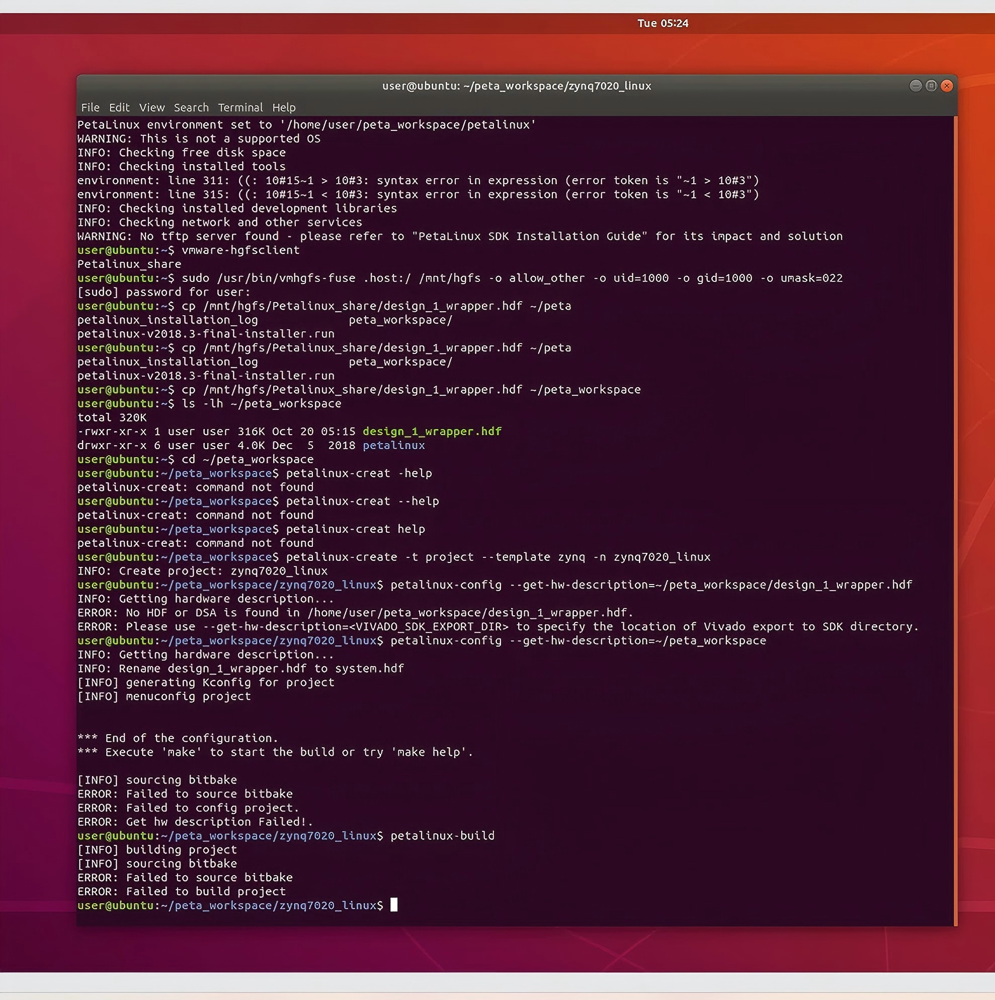
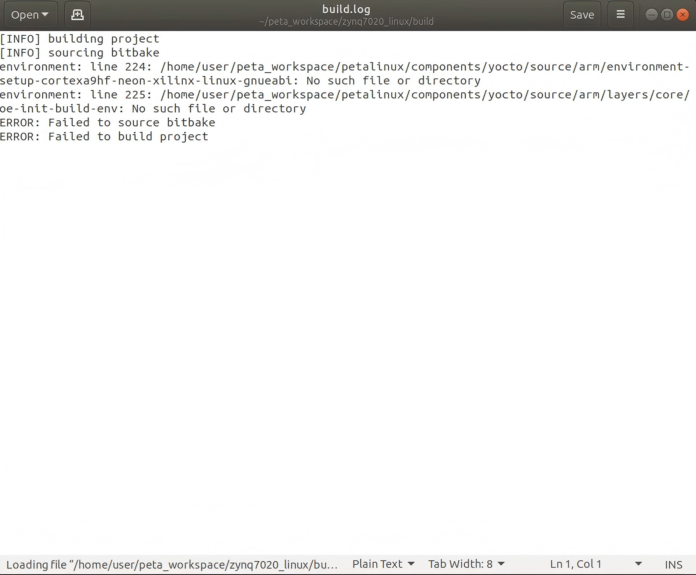
``` bash
cp ~/peta_workspace/petalinux/components/yocto/source/environment-setup-cortexa9hf-neon-xilinx-linux-gnueabi ~/peta_workspace/petalinux/components/yocto/source/arm/

cp ~/peta_workspace/petalinux/components/yocto/source/site-config-cortexa9hf-neon-xilinx-linux-gnueabi ~/peta_workspace/petalinux/components/yocto/source/arm/

cp ~/peta_workspace/petalinux/components/yocto/source/version-cortexa9hf-neon-xilinx-linux-gnueabi ~/peta_workspace/petalinux/components/yocto/source/arm/

cp -r ~/peta_workspace/petalinux/components/yocto/source/layers ~/peta_workspace/petalinux/components/yocto/source/arm/
```

最后执行编译指令。等待了大概20分钟，完成编译！
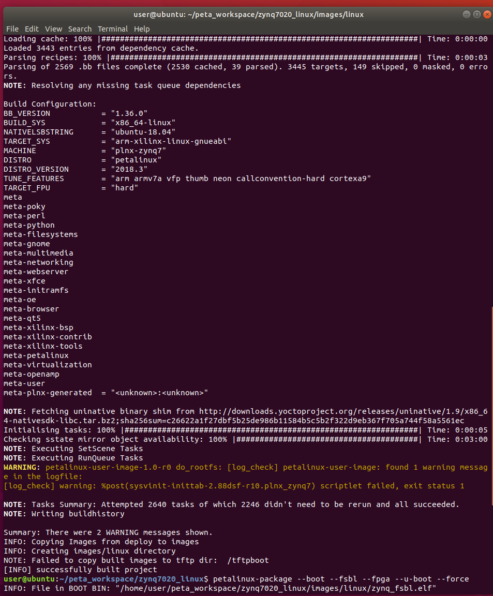
因为 Zynq 启动需要 FSBL(第一级启动引导)、U-Boot 和 FPGA 的比特流(Bitstream)打包在一起，形成一个 BOOT.BIN。
``` bash
petalinux-package --boot --fsbl --fpga --u-boot --force
```

可以在工程文件夹下的/images/linux/下看到新生成的BOOT.BIN和image.ub
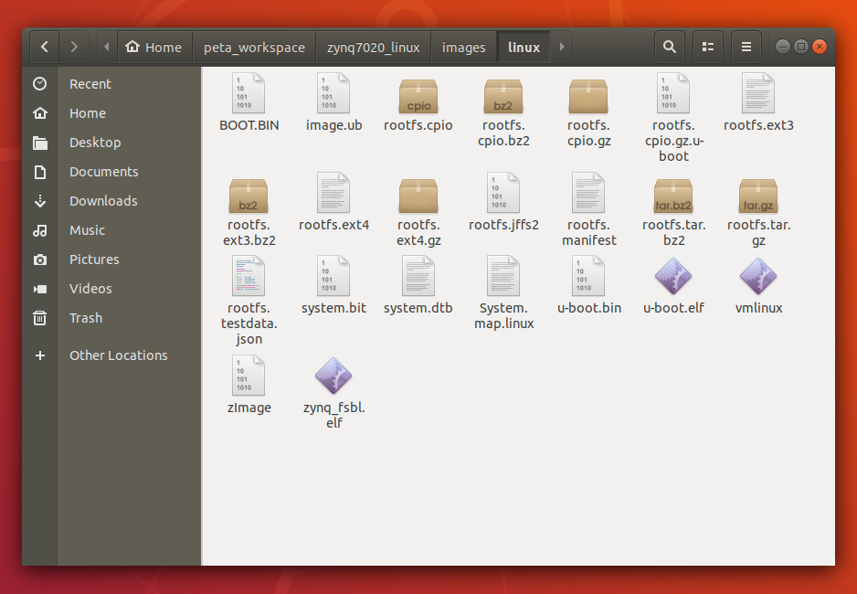
|文件| 内容 |
|:---:|:---:|
|BOOT.BIN| 包含 FPGA 硬件配置、FSBL 和 U-Boot 的启动文件 |
|image.ub| 包含 Linux 内核、设备树和根文件系统的镜像 |

把他们搞到共享文件夹里面，然后在Windows里面拷到SD卡里面，注意SD卡必须提前格式化为FAT32格式，这是Zynq唯一认识的格式。
